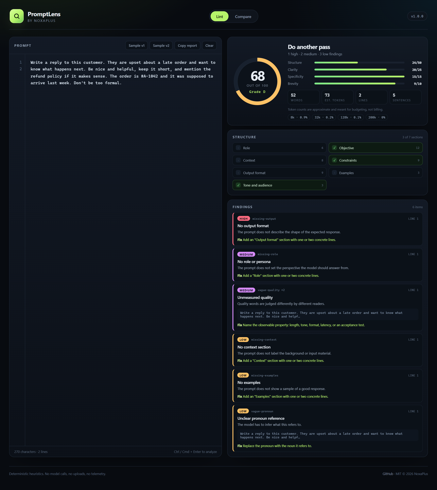
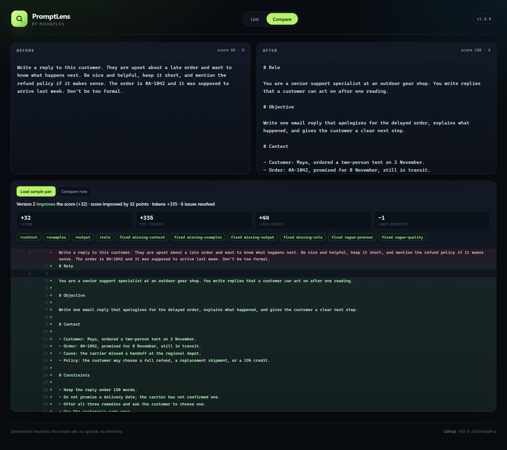

# NoxaPlus PromptLens

**Your prompt is not bad. It is just missing the parts the model needed.**

PromptLens reads a prompt the way a picky reviewer would: does it say who is speaking, what "done" looks like, what to avoid, and how the answer should be shaped? It flags vague wording, unfilled placeholders, duplicated instructions, and sentences that are carrying three jobs at once. Then it scores the whole thing out of 100 and shows you which lines cost you points. No model calls, no uploads, no account.

[](https://github.com/noxaplus-star/noxaplus-promptlens/actions/workflows/ci.yml)
[](LICENSE)
[](https://nodejs.org/)

[GitHub repository](https://github.com/noxaplus-star/noxaplus-promptlens) · [NoxaPlus](https://www.noxaplus.ir)



## Why this exists

Most prompt problems are not model problems. They are missing information. A prompt asks for "a good reply" and never defines good. It says "be helpful" and leaves the reader to guess what helpful means. It pastes an order number but never labels it. The model fills the gaps with something plausible, you rewrite the prompt, and the cycle repeats.

PromptLens catches that before you spend another request. It is deliberately deterministic: the same text always produces the same score and the same findings. You can put it in a pre-commit hook, a CI job, or a review checklist and argue about the result instead of arguing about vibes.

## Quick start

Requires Node.js 22 or newer. There are no runtime dependencies.

```bash
git clone https://github.com/noxaplus-star/noxaplus-promptlens.git
cd noxaplus-promptlens
npm ci
npm run build
node dist/cli.js lint examples/support-reply.v1.md
```

Install the release package globally if you want the `promptlens` command anywhere:

```bash
npm install -g https://github.com/noxaplus-star/noxaplus-promptlens/releases/download/v1.0.0/noxaplus-promptlens-1.0.0.tgz
promptlens lint prompt.md
```

A vague prompt gets a very direct answer:

```text
NoxaPlus PromptLens 1.0.0
52 words · 73 est. tokens · 2 lines · 5 sentences

Score 68 / 100  (D)
  Structure    24 / 50
  Clarity      20 / 25
  Specificity  15 / 15
  Brevity       9 / 10

Structure
  [ ] Role               6 pts
  [x] Objective         12 pts  Write a reply to this customer. They are upset about a late ord…
  [ ] Context            8 pts
  [x] Constraints        9 pts  Write a reply to this customer. They are upset about a late ord…
  [ ] Output format      9 pts
  [ ] Examples           3 pts
  [x] Tone and audience  3 pts  Write a reply to this customer. They are upset about a late ord…

Findings (6: 1 high · 2 medium · 3 low)
  HIGH   line 1   No output format (missing-output)
         The prompt does not describe the shape of the expected response.
         → Add an "Output format" section with one or two concrete lines.
  MEDIUM line 1   No role or persona (missing-role)
         The prompt does not set the perspective the model should answer from.
         → Add a "Role" section with one or two concrete lines.
  MEDIUM line 1   Unmeasured quality ×2 (vague-quality)
         Quality words are judged differently by different readers.
         → Name the observable property: length, tone, format, latency, or an acceptance test.
  LOW    line 1   No context section (missing-context)
  LOW    line 1   No examples (missing-examples)
  LOW    line 1   Unclear pronoun reference (vague-pronoun)
```

The same prompt, restructured into labeled sections, scores 100 and produces no findings. Both versions live in [`examples/`](examples).

## What it checks

PromptLens ships 22 rules. Fifteen look at wording; seven look at whether the prompt has the sections a model actually needs.

### Wording

| Rule | Severity | What it catches |
| --- | --- | --- |
| `placeholder` | high | `[INSERT NAME]`, `TODO`, `XXX`, `<your value here>` left in the text |
| `vague-quantifier` | medium | "some", "a few", "several", "many" where a number belongs |
| `hedge` | medium | "maybe", "perhaps", "if possible", "try to" turning an instruction into a suggestion |
| `vague-quality` | medium | "good", "nice", "helpful", "professional" with no observable definition |
| `open-ended` | medium | "etc.", "and so on", "anything else" that leaves the boundary undefined |
| `weak-instruction` | medium | "you could", "feel free to", "it would be great if" |
| `subjective-style` | low | "engaging", "compelling", "high-quality" — opinions wearing a requirement's clothes |
| `etcetera` | low | lists that end in a shrug |
| `first-person-wish` | low | "I want you to", "I'd like" instead of a direct instruction |
| `vague-pronoun` | low | sentences that begin with "it", "this", or "they" and make the reader hunt for the noun |
| `vague-time` | low | "soon", "later", "recently", "in a while" |
| `unspecified-comparison` | low | "better", "faster", "cheaper" without a baseline |
| `repeated-word` | low | the same word doing the same job twice in a row |
| `absolute-language` | info | "always", "never", "every", "guaranteed" — often a promise the model cannot keep |
| `assumed-knowledge` | low | "as discussed", "the usual format", "like before" with no context in the prompt |

### Structure

| Rule | Severity | What it looks for |
| --- | --- | --- |
| `missing-objective` | high | no clear action or deliverable |
| `missing-output` | high | no description of the response's shape |
| `missing-constraints` | medium | no limits, exclusions, or guardrails |
| `missing-role` | medium | no perspective or persona |
| `missing-context` | low | no labeled background or input material |
| `missing-examples` | low | no sample of a good response |
| `missing-tone` | info | no tone or audience |

Sections are detected from Markdown headings, `Label:` lines, and short all-caps labels. A section counts only when it has content under it, so `# Context` followed by a blank line does not earn points.

Run `promptlens rules` for the same list with IDs and severities.

## The score, explained

Every prompt starts at 0 and earns its way up. There are no hidden bonuses and no random jitter.

| Part | Points | How it is earned |
| --- | --- | --- |
| Structure | 50 | Section weights: objective 12, constraints 9, output 9, context 8, role 6, examples 3, tone 3 |
| Clarity | 25 | Starts at 25; high findings cost 6, medium 4, low 1 |
| Specificity | 15 | Starts at 15; vague wording and placeholders reduce it |
| Brevity | 10 | Starts at 10; long sentences, shouting, and oversized prompts reduce it |

Grades are A at 90+, B at 80, C at 70, D at 60, and F below that. An empty prompt scores 0, not a charitable 40.

The score is a review tool, not a truth machine. A 100 means the prompt gives the model every part it needs in a form a reader can check. It does not mean the model will produce a good answer, and a deliberately terse prompt may deserve better than it gets.

## Compare two versions

Prompt drift is real: someone tightens one sentence, removes a constraint, and the output quietly changes. `diff` re-lints both versions and tells you what moved.

```bash
promptlens diff examples/support-reply.v1.md examples/support-reply.v2.md
```

```text
before  52 words · 73 tokens · score 68 (D)
after   237 words · 408 tokens · score 100 (A)

score improved by 32 points · tokens +335 · 6 issues resolved
Sections gained: context, examples, output, role
Resolved: missing-context, missing-examples, missing-output, missing-role, vague-pronoun, vague-quality
```

The report includes a line diff, so a prompt that gains 32 points by growing six times larger is visible as exactly that trade. Add `--fail-on-regression` to exit 1 when the new version scores lower than the old one — useful in CI when prompts are treated like code.



## The dashboard

`promptlens serve` starts a local, self-contained dashboard on `http://127.0.0.1:4020`. It has two views: **Lint**, which scores one prompt and explains each finding, and **Compare**, which shows the before/after delta and the line diff. Both views load the bundled examples, so you can see the tool working before pasting anything real.

The page is a single HTML document served from memory. There is no build step for the frontend, no analytics, and no external asset request. Binds to loopback by default; pass `--host 0.0.0.0` only if you mean it.

### HTTP API

The same server exposes the engine as JSON, which makes it easy to wire into an editor or a script.

| Method | Route | Body | Returns |
| --- | --- | --- | --- |
| `GET` | `/api/health` | — | version and status |
| `GET` | `/api/rules` | — | the 22-rule catalog |
| `GET` | `/api/samples` | — | the bundled example prompts |
| `POST` | `/api/lint` | `{ "prompt": "..." }` | a full lint report |
| `POST` | `/api/diff` | `{ "before": "...", "after": "..." }` | score delta and line diff |

```bash
curl -s http://127.0.0.1:4020/api/lint \
  -H 'content-type: application/json' \
  -d '{"prompt":"Write a good blog post about our launch."}'
```

## CLI reference

```text
promptlens <file> [options]
promptlens lint <file|-> [options]
promptlens diff <before> <after> [options]
promptlens serve [--port 4020] [--host 127.0.0.1]
promptlens sample [v1|v2]
promptlens rules
```

| Option | Meaning |
| --- | --- |
| `--format <text\|json>` | Report format (default: `text`) |
| `--out <path>` | Write the report to a file instead of stdout |
| `--fail-under <0..100>` | Exit 1 when the score is below the given number |
| `--fail-on-regression` | Exit 1 when the new version scores lower than the old one |
| `--no-color` | Disable ANSI colors |
| `--quiet` | Suppress the "report written" status line |
| `--port <number>` | Dashboard port (default: `4020`) |
| `--host <address>` | Dashboard bind address (default: `127.0.0.1`) |

`-` reads the prompt from stdin. Exit codes are `0` for a prompt that passed the requested checks, `1` for a failed threshold or regression, and `2` for invalid usage, an unreadable file, or a server error.

JSON output is stable and includes `stats`, `structure`, `missingSections`, `findings`, `counts`, `score`, and `contextUsage`. Use `--format json` when another tool needs to read the result.

## Token estimates

The token count is an approximation built from word length, CJK characters, punctuation, and line breaks. It is designed for budgeting and for spotting prompts that quietly grew past a context window. It is not generated by a tokenizer and it will not match a bill. The dashboard shows usage against 8k, 32k, 128k, and 200k windows; the report labels it "est. tokens" everywhere for that reason.

## Privacy

PromptLens reads the file you point it at and prints a report. It makes no network requests, calls no model, and writes nothing except the report you ask for. The dashboard runs on your machine, serves its own HTML, and keeps no history. If the prompt is sensitive, the tool never sees anything you did not paste.

## Where it stops

- **Heuristics, not comprehension.** It can tell that "make it better" is undefined; it cannot tell whether your definition of better is the right one.
- **Tuned for English.** The wording rules are English regexes and labels. Structure detection works more broadly, but clarity scoring does not.
- **A high score is not an evaluation.** PromptLens checks the instructions a model receives, not the answers it gives.
- **Not a grader for model output.** There is no second model, no rubric matching, and no "did the answer follow the prompt" check.

If a rule fires on a prompt where the phrasing is intentional, that is useful feedback too: the rule is too broad for your use case, and the rule list is small enough to read.

## Development

```bash
npm ci
npm run typecheck
npm test
npm run build
npm run serve
```

The test suite covers the tokenizer, structure detection, all lint rules, the diff engine, the CLI (including exit codes and stdin), and the HTTP server. `npm run lint:sample` lints the bundled vague example as a smoke test.

Layout:

- `src/tokenizer.ts` — word and token estimation
- `src/structure.ts` — the seven section detectors
- `src/rules.ts` — the wording rules
- `src/lint.ts` — scoring and report assembly
- `src/diff.ts` — line diff and regression summary
- `src/report.ts` — text renderers
- `src/server.ts` — HTTP API and static dashboard
- `src/dashboard.ts` — the dashboard itself
- `src/cli.ts` — argument parsing and commands

## License

MIT © 2026 NoxaPlus. See [LICENSE](LICENSE).

Built and maintained by [NoxaPlus](https://www.noxaplus.ir). If PromptLens saves you a rewrite, a star helps someone else find it.
